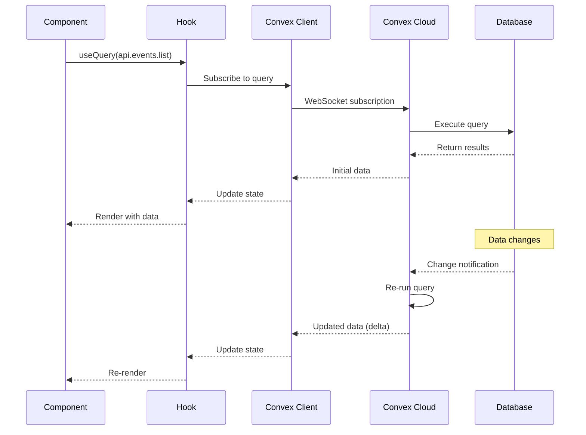
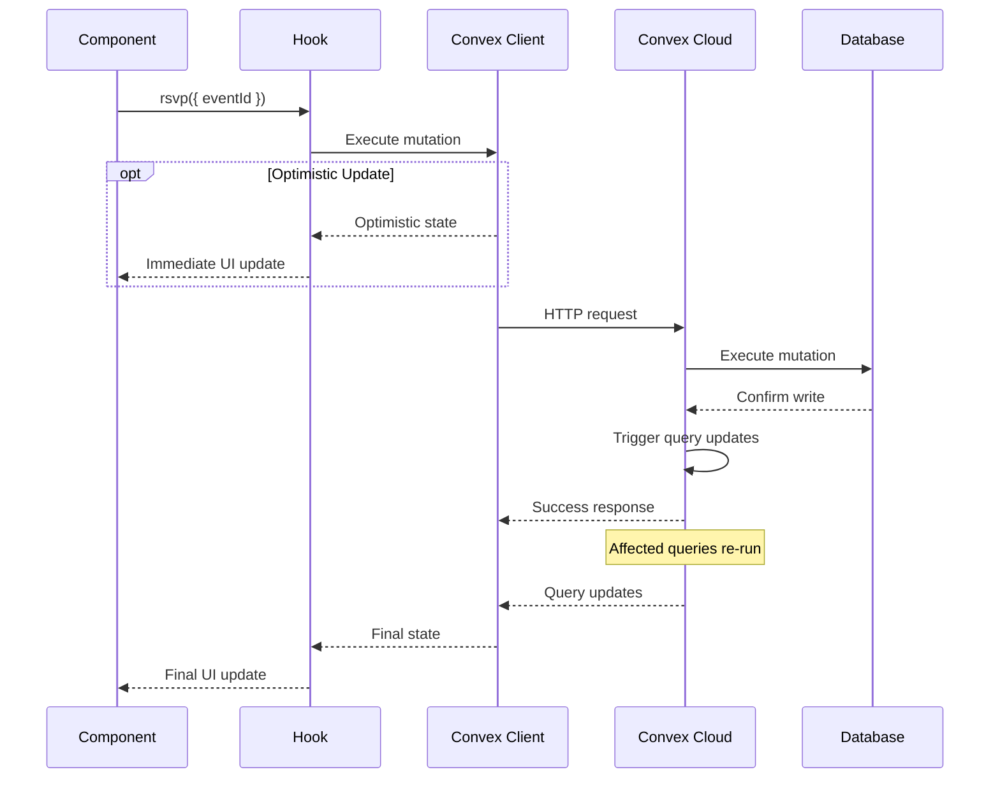
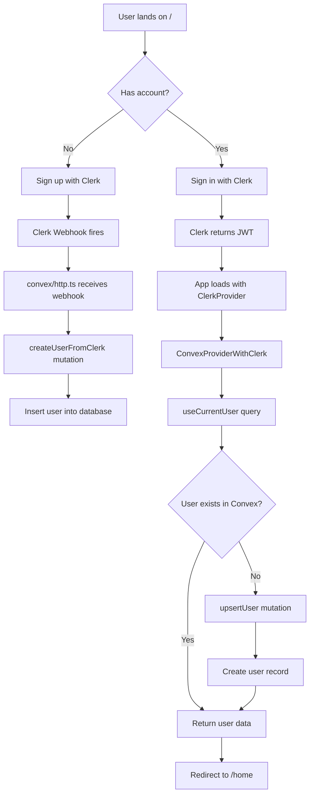
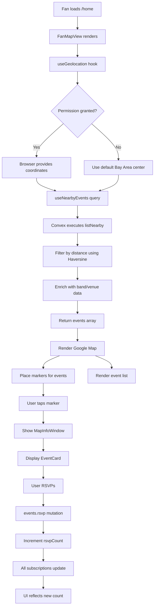
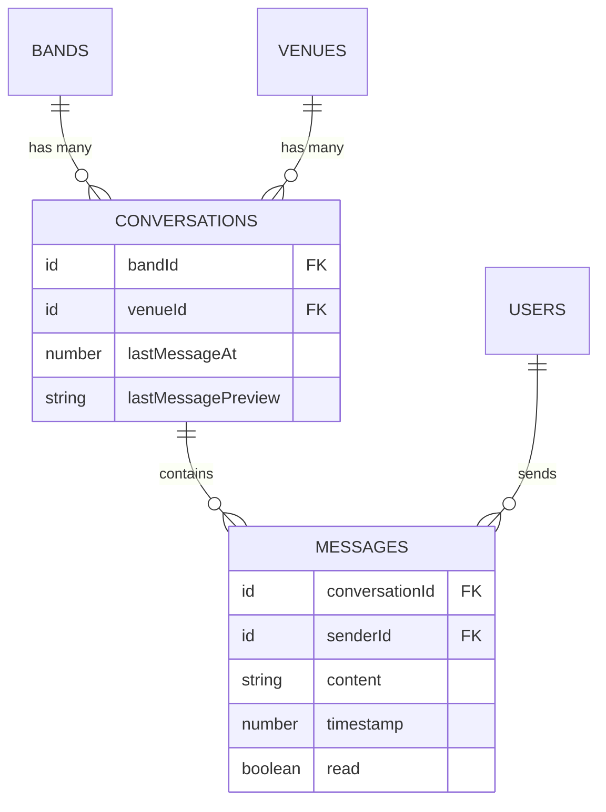
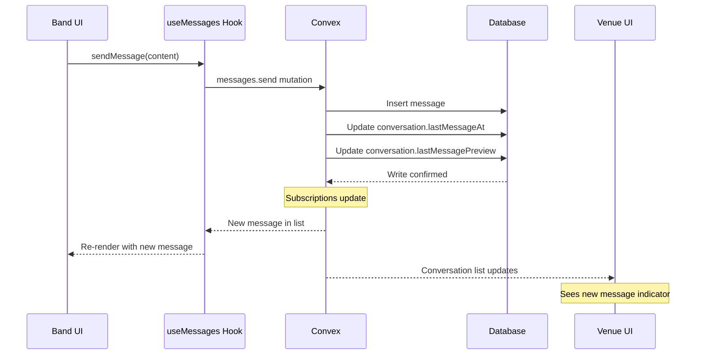
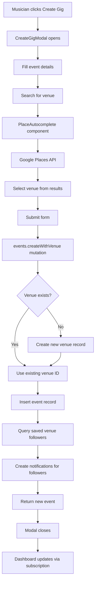

# Data Flow

This document describes how data flows through the Ear-Plug application, including request lifecycles, state management with Convex, and data transformation patterns.

## Related Diagrams

For visual representations of data flows, see:

- **[User Registration Flow](../diagrams/sequence-diagrams/user-registration.mermaid)** - Complete authentication and user creation sequence
- **[Event Creation Flow](../diagrams/sequence-diagrams/event-creation.mermaid)** - Musician creates event with venue lookup and notifications
- **[RSVP Flow](../diagrams/sequence-diagrams/rsvp-flow.mermaid)** - Fan RSVPs with real-time count updates
- **[Messaging Flow](../diagrams/sequence-diagrams/messaging-flow.mermaid)** - Band-venue conversation with real-time sync
- **[System Overview](../diagrams/system-overview.mermaid)** - High-level component interactions

## Overview

Ear-Plug uses Convex as its backend, which provides a fundamentally different data flow model than traditional REST or GraphQL APIs. Key characteristics:

- **Real-time subscriptions**: Queries automatically update when underlying data changes
- **Optimistic updates**: Mutations can update UI immediately while processing
- **No cache invalidation**: The subscription model eliminates manual cache management

## Request Lifecycle

### Query Lifecycle



### Mutation Lifecycle



## State Management

### Local State vs Server State

| Type | Technology | Use Case |
|------|------------|----------|
| Server State | Convex Queries | All persisted data (users, events, etc.) |
| UI State | React useState | Form inputs, modal visibility, loading states |
| Auth State | Clerk | Authentication, session, user identity |
| Device State | Browser APIs | Geolocation, localStorage |

### Convex State Patterns

#### Query Pattern

```typescript
// apps/web/src/hooks/useEvents.ts
export function useEvents(options?: { limit?: number; genre?: Genre }) {
  const events = useQuery(
    api.events.listUpcoming,
    options ?? {}
  );

  return {
    events: events ?? [],
    isLoading: events === undefined,
    isEmpty: events !== undefined && events.length === 0,
  };
}
```

#### Conditional Query Pattern

Use `"skip"` to conditionally execute queries:

```typescript
export function useNearbyEvents(location?: { lat: number; lng: number }) {
  const events = useQuery(
    api.events.listNearby,
    location
      ? { latitude: location.lat, longitude: location.lng, radiusMiles: 25 }
      : "skip"  // Don't execute until we have location
  );

  return {
    events: events ?? [],
    isLoading: events === undefined && location !== undefined,
  };
}
```

#### Mutation Pattern

```typescript
export function useEventActions() {
  const rsvpMutation = useMutation(api.events.rsvp);
  const likeMutation = useMutation(api.events.toggleLike);

  const rsvp = async (eventId: Id<"events">) => {
    await rsvpMutation({ eventId });
    // No need to refetch - subscriptions update automatically
  };

  const toggleLike = async (eventId: Id<"events">) => {
    await likeMutation({ eventId });
  };

  return { rsvp, toggleLike };
}
```

## Data Transformation Layers

### Layer 1: Convex Backend

Data is enriched at the backend before being sent to clients:

```typescript
// convex/events.ts
export const listUpcoming = query({
  args: { limit: v.optional(v.number()) },
  handler: async (ctx, args) => {
    const events = await ctx.db
      .query("events")
      .withIndex("by_date")
      .filter((q) => q.gte(q.field("dateTime"), Date.now()))
      .take(args.limit || 50);

    // Enrich with related data
    return await Promise.all(
      events.map(async (event) => {
        const band = await ctx.db.get(event.bandId);
        const venue = await ctx.db.get(event.venueId);
        return { ...event, band, venue };
      })
    );
  },
});
```

### Layer 2: Custom Hooks

Hooks provide computed properties and loading states:

```typescript
// apps/web/src/hooks/useUser.ts
export function useCurrentUser() {
  const user = useQuery(api.users.getCurrentUser);

  return {
    user,
    isLoading: user === undefined,
    isAuthenticated: user !== null,
    isFan: user?.role === "fan",
    isMusician: user?.role === "musician",
  };
}
```

### Layer 3: Components

Components handle display formatting:

```typescript
// apps/web/src/components/events/EventCard.tsx
function EventCard({ event }: { event: EventWithDetails }) {
  const formattedDate = formatEventDate(event.dateTime);
  const displayPrice = event.price ? formatPrice(event.price) : "Free";

  return (
    <div className="card-brutalist">
      <h3>{event.title}</h3>
      <p>{event.band?.name} at {event.venue?.name}</p>
      <p>{formattedDate}</p>
      <p>{displayPrice}</p>
    </div>
  );
}
```

## Authentication Data Flow

### User Creation Flow



### Role Selection Flow

```typescript
// apps/web/src/app/(app)/layout.tsx
export default function AppLayout({ children }) {
  const { user, isLoading } = useCurrentUser();
  const updateRole = useMutation(api.users.updateRole);
  const [storedRole] = useLocalStorage<UserRole>("selectedRole");

  useEffect(() => {
    // Sync localStorage role to database on first load
    if (user && storedRole && user.role !== storedRole) {
      updateRole({ role: storedRole });
    }
  }, [user, storedRole]);

  if (isLoading) {
    return <LoadingState />;
  }

  return <>{children}</>;
}
```

## Event Discovery Flow (Fan)



## Messaging Flow

### Conversation Data Model



### Message Send Flow



## Event Creation Flow (Musician)



## Geospatial Data Flow

### Distance Calculation

The application uses the Haversine formula for calculating distances between coordinates:

```typescript
// convex/utils/geo.ts
export function haversineDistance(
  lat1: number, lng1: number,
  lat2: number, lng2: number
): number {
  const R = 3959; // Earth's radius in miles
  const dLat = toRad(lat2 - lat1);
  const dLng = toRad(lng2 - lng1);

  const a =
    Math.sin(dLat / 2) * Math.sin(dLat / 2) +
    Math.cos(toRad(lat1)) * Math.cos(toRad(lat2)) *
    Math.sin(dLng / 2) * Math.sin(dLng / 2);

  const c = 2 * Math.atan2(Math.sqrt(a), Math.sqrt(1 - a));
  return R * c;
}
```

### Nearby Events Query

```typescript
// convex/events.ts
export const listNearby = query({
  args: {
    latitude: v.number(),
    longitude: v.number(),
    radiusMiles: v.optional(v.number()),
  },
  handler: async (ctx, args) => {
    const radius = args.radiusMiles || 25;
    const events = await ctx.db.query("events").collect();

    const nearbyEvents = await Promise.all(
      events.map(async (event) => {
        const venue = await ctx.db.get(event.venueId);
        if (!venue) return null;

        const distance = haversineDistance(
          args.latitude, args.longitude,
          venue.coordinates.lat, venue.coordinates.lng
        );

        if (distance <= radius) {
          const band = await ctx.db.get(event.bandId);
          return { ...event, band, venue, distance };
        }
        return null;
      })
    );

    return nearbyEvents
      .filter(Boolean)
      .sort((a, b) => a.distance - b.distance);
  },
});
```

## Caching Strategy

### Turborepo Build Cache

```json
// turbo.json
{
  "tasks": {
    "build": {
      "dependsOn": ["^build"],
      "outputs": [".next/**", "!.next/cache/**", "dist/**"]
    }
  }
}
```

### Convex Query Cache

Convex handles caching automatically:

1. **Query deduplication**: Multiple components subscribing to the same query share one subscription
2. **Reactive updates**: Cache invalidation happens automatically when mutations affect query results
3. **Connection management**: WebSocket connections are pooled and reused

### Browser Caching

```typescript
// apps/web/src/hooks/useLocalStorage.ts
export function useLocalStorage<T>(key: string, initialValue?: T) {
  const [storedValue, setStoredValue] = useState<T | undefined>(() => {
    if (typeof window === "undefined") return initialValue;

    const item = window.localStorage.getItem(key);
    return item ? JSON.parse(item) : initialValue;
  });

  const setValue = (value: T) => {
    setStoredValue(value);
    window.localStorage.setItem(key, JSON.stringify(value));
  };

  return [storedValue, setValue] as const;
}
```

## Error Handling Flow

### Backend Errors

```typescript
// convex/events.ts
export const rsvp = mutation({
  args: { eventId: v.id("events") },
  handler: async (ctx, args) => {
    const identity = await ctx.auth.getUserIdentity();
    if (!identity) {
      throw new Error("Not authenticated");
    }

    const event = await ctx.db.get(args.eventId);
    if (!event) {
      throw new Error("Event not found");
    }

    if (event.rsvpCount >= event.capacity) {
      throw new Error("Event is at capacity");
    }

    // ... proceed with RSVP
  },
});
```

### Frontend Error Handling

```typescript
// Component error handling
const handleRsvp = async () => {
  setIsLoading(true);
  try {
    await rsvp({ eventId: event._id });
  } catch (error) {
    if (error instanceof Error) {
      console.error("RSVP failed:", error.message);
      // Show user-friendly error message
    }
  } finally {
    setIsLoading(false);
  }
};
```
