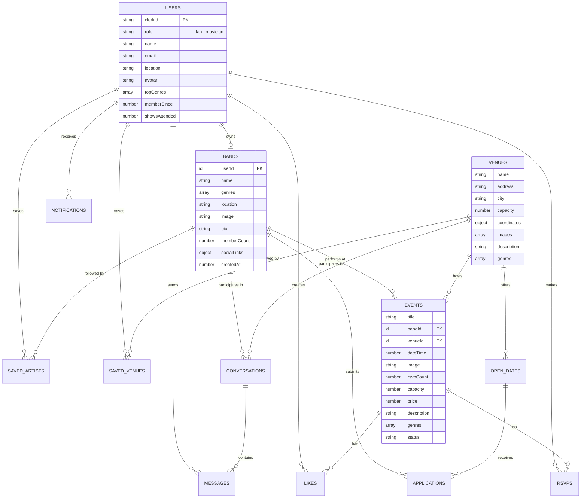

# Database Schema

This document describes the Convex database schema, entity relationships, indexes, and query patterns used in the Ear-Plug application.

## Overview

Ear-Plug uses Convex as its serverless database. The schema is defined in TypeScript using Convex validators, which provide both runtime validation and TypeScript type inference.

**Key Characteristics:**
- 13 tables with defined schemas
- Document-based storage with references via IDs
- Indexed fields for efficient queries
- Real-time subscriptions for all queries

## Entity Relationship Diagram

For a comprehensive ER diagram with all 13 tables and their relationships, see:

- **[Entity Relationship Diagram](../diagrams/entity-relationship.mermaid)** - Complete database schema with all fields, types, and relationships

For status transition diagrams, see:

- **[Event Status States](../diagrams/state-diagrams/event-status.mermaid)** - Event status transitions (confirmed/hold/available)
- **[Application Status States](../diagrams/state-diagrams/application-status.mermaid)** - Open date application status flow



## Table Definitions

### Users

Stores user profiles linked to Clerk authentication.

```typescript
users: defineTable({
  clerkId: v.string(),           // Clerk user ID
  role: userRoleValidator,        // "fan" | "musician"
  name: v.string(),
  email: v.string(),
  location: v.optional(v.string()),
  avatar: v.optional(v.string()),
  topGenres: v.optional(v.array(genreValidator)),
  memberSince: v.number(),        // Unix timestamp
  showsAttended: v.optional(v.number()),
})
  .index("by_clerk_id", ["clerkId"])
  .index("by_email", ["email"])
  .index("by_role", ["role"])
```

**Indexes:**
| Index | Fields | Purpose |
|-------|--------|---------|
| `by_clerk_id` | `clerkId` | Lookup user by Clerk ID for authentication |
| `by_email` | `email` | Find user by email (webhook deduplication) |
| `by_role` | `role` | Query users by role (fan/musician) |

### Bands

Stores musician band profiles.

```typescript
bands: defineTable({
  userId: v.id("users"),          // Owner (musician user)
  name: v.string(),
  genres: v.optional(v.array(genreValidator)),
  genre: v.optional(genreValidator),  // Legacy field
  location: v.string(),
  image: v.optional(v.string()),
  bio: v.optional(v.string()),
  memberCount: v.optional(v.number()),
  socialLinks: v.optional(socialLinksValidator),
  createdAt: v.number(),
})
  .index("by_user", ["userId"])
  .index("by_name", ["name"])
```

**Social Links Structure:**
```typescript
{
  spotify?: string,
  appleMusic?: string,
  instagram?: string,
  tiktok?: string,
  youtube?: string,
  website?: string,
}
```

### Venues

Stores Bay Area venue information.

```typescript
venues: defineTable({
  name: v.string(),
  address: v.string(),
  city: v.string(),
  capacity: v.number(),
  coordinates: coordinatesValidator,  // { lat: number, lng: number }
  images: v.optional(v.array(v.string())),
  description: v.optional(v.string()),
  genres: v.optional(v.array(genreValidator)),
})
  .index("by_city", ["city"])
  .index("by_name", ["name"])
```

### Events

Stores live music shows.

```typescript
events: defineTable({
  title: v.string(),
  bandId: v.id("bands"),
  venueId: v.id("venues"),
  dateTime: v.number(),           // Unix timestamp
  image: v.optional(v.string()),
  rsvpCount: v.number(),
  capacity: v.number(),
  price: v.optional(v.number()),  // In cents
  description: v.optional(v.string()),
  genres: v.optional(v.array(genreValidator)),
  genre: v.optional(genreValidator),  // Legacy field
  status: eventStatusValidator,   // "confirmed" | "hold" | "available"
})
  .index("by_band", ["bandId"])
  .index("by_venue", ["venueId"])
  .index("by_date", ["dateTime"])
  .index("by_status", ["status"])
```

**Event Status Values:**
| Status | Description |
|--------|-------------|
| `confirmed` | Booked and confirmed show |
| `hold` | Tentative booking |
| `available` | Open slot |

### RSVPs

Tracks user RSVPs to events.

```typescript
rsvps: defineTable({
  userId: v.id("users"),
  eventId: v.id("events"),
  createdAt: v.number(),
})
  .index("by_user", ["userId"])
  .index("by_event", ["eventId"])
  .index("by_user_event", ["userId", "eventId"])
```

### Likes

Tracks user likes on events.

```typescript
likes: defineTable({
  userId: v.id("users"),
  eventId: v.id("events"),
  createdAt: v.number(),
})
  .index("by_user", ["userId"])
  .index("by_event", ["eventId"])
  .index("by_user_event", ["userId", "eventId"])
```

### Saved Artists

Tracks fan follows for bands.

```typescript
savedArtists: defineTable({
  userId: v.id("users"),
  bandId: v.id("bands"),
  createdAt: v.number(),
})
  .index("by_user", ["userId"])
  .index("by_band", ["bandId"])
  .index("by_user_band", ["userId", "bandId"])
```

### Saved Venues

Tracks fan saved venues.

```typescript
savedVenues: defineTable({
  userId: v.id("users"),
  venueId: v.id("venues"),
  createdAt: v.number(),
})
  .index("by_user", ["userId"])
  .index("by_venue", ["venueId"])
  .index("by_user_venue", ["userId", "venueId"])
```

### Conversations

Stores band-venue messaging threads.

```typescript
conversations: defineTable({
  bandId: v.id("bands"),
  venueId: v.id("venues"),
  lastMessageAt: v.number(),
  lastMessagePreview: v.optional(v.string()),
})
  .index("by_band", ["bandId"])
  .index("by_venue", ["venueId"])
  .index("by_band_venue", ["bandId", "venueId"])
  .index("by_last_message", ["lastMessageAt"])
```

### Messages

Stores individual messages within conversations.

```typescript
messages: defineTable({
  conversationId: v.id("conversations"),
  senderId: v.id("users"),
  content: v.string(),
  timestamp: v.number(),
  read: v.boolean(),
})
  .index("by_conversation", ["conversationId"])
  .index("by_sender", ["senderId"])
  .index("by_timestamp", ["timestamp"])
```

### Notifications

Stores user notifications.

```typescript
notifications: defineTable({
  userId: v.id("users"),
  type: notificationTypeValidator,
  title: v.string(),
  content: v.string(),
  timestamp: v.number(),
  read: v.boolean(),
  eventId: v.optional(v.id("events")),
  bandId: v.optional(v.id("bands")),
  venueId: v.optional(v.id("venues")),
})
  .index("by_user", ["userId"])
  .index("by_user_read", ["userId", "read"])
  .index("by_timestamp", ["timestamp"])
```

**Notification Types:**
| Type | Description |
|------|-------------|
| `event_reminder` | Upcoming event reminder |
| `lineup_change` | Event lineup has changed |
| `new_event_followed_artist` | Followed artist announced new show |
| `new_event_nearby` | New event in user's area |
| `application_update` | Booking application status changed |
| `message` | New message received |

### Open Dates

Stores venue booking opportunities.

```typescript
openDates: defineTable({
  venueId: v.id("venues"),
  date: v.number(),               // Unix timestamp
  offeredPay: v.optional(v.number()),  // In cents
  genre: v.optional(genreValidator),
  status: openDateStatusValidator,
  description: v.optional(v.string()),
  createdAt: v.number(),
})
  .index("by_venue", ["venueId"])
  .index("by_date", ["date"])
  .index("by_status", ["status"])
  .index("by_genre", ["genre"])
```

**Open Date Status Values:**
| Status | Description |
|--------|-------------|
| `open` | Available for applications |
| `pending` | Has applications under review |
| `filled` | Booked |

### Applications

Stores band applications to open dates.

```typescript
applications: defineTable({
  bandId: v.id("bands"),
  openDateId: v.id("openDates"),
  status: applicationStatusValidator,
  message: v.optional(v.string()),
  appliedAt: v.number(),
  respondedAt: v.optional(v.number()),
})
  .index("by_band", ["bandId"])
  .index("by_open_date", ["openDateId"])
  .index("by_band_open_date", ["bandId", "openDateId"])
  .index("by_status", ["status"])
```

**Application Status Values:**
| Status | Description |
|--------|-------------|
| `pending` | Awaiting venue review |
| `accepted` | Application accepted |
| `rejected` | Application rejected |

## Validators

### Genre Validator

```typescript
const genreValidator = v.union(
  v.literal("indie"),
  v.literal("rock"),
  v.literal("jazz"),
  v.literal("electronic"),
  v.literal("folk"),
  v.literal("pop"),
  v.literal("alternative")
);
```

### User Role Validator

```typescript
const userRoleValidator = v.union(
  v.literal("fan"),
  v.literal("musician")
);
```

### Coordinates Validator

```typescript
const coordinatesValidator = v.object({
  lat: v.number(),
  lng: v.number(),
});
```

## Query Patterns

### Lookup by ID

```typescript
// Get a single document by ID
const event = await ctx.db.get(eventId);
```

### Index-Based Queries

```typescript
// Query using an index
const user = await ctx.db
  .query("users")
  .withIndex("by_clerk_id", (q) => q.eq("clerkId", clerkId))
  .unique();
```

### Filtered Queries

```typescript
// Query with filter
const upcomingEvents = await ctx.db
  .query("events")
  .withIndex("by_date")
  .filter((q) => q.gte(q.field("dateTime"), Date.now()))
  .take(50);
```

### Compound Index Queries

```typescript
// Check if relationship exists
const existingRsvp = await ctx.db
  .query("rsvps")
  .withIndex("by_user_event", (q) =>
    q.eq("userId", userId).eq("eventId", eventId)
  )
  .unique();
```

### Related Data Enrichment

```typescript
// Fetch related documents
const eventsWithDetails = await Promise.all(
  events.map(async (event) => {
    const band = await ctx.db.get(event.bandId);
    const venue = await ctx.db.get(event.venueId);
    return { ...event, band, venue };
  })
);
```

## Index Strategy

### Single-Field Indexes

Used for common lookup patterns:

| Table | Index | Use Case |
|-------|-------|----------|
| `users` | `by_clerk_id` | Auth lookup |
| `events` | `by_date` | Chronological listing |
| `events` | `by_status` | Filter by status |
| `notifications` | `by_timestamp` | Recent notifications |

### Compound Indexes

Used for uniqueness checks and relationship queries:

| Table | Index | Use Case |
|-------|-------|----------|
| `rsvps` | `by_user_event` | Check if user RSVPed |
| `likes` | `by_user_event` | Check if user liked |
| `savedArtists` | `by_user_band` | Check if user follows band |
| `conversations` | `by_band_venue` | Find existing conversation |

### Index Selection Guidelines

1. **Always use indexes** for queries that filter data
2. **Compound indexes** for uniqueness constraints (no duplicate RSVPs)
3. **Timestamp indexes** for chronological queries
4. **Foreign key indexes** for relationship lookups

## Data Integrity

### Referential Integrity

Convex does not enforce foreign key constraints at the database level. Integrity is maintained through:

1. **Application-level checks**: Verify referenced documents exist before mutations
2. **Cascading deletes**: Manually implemented in mutation handlers

```typescript
// Example: Check band exists before creating event
export const create = mutation({
  args: { bandId: v.id("bands"), ... },
  handler: async (ctx, args) => {
    const band = await ctx.db.get(args.bandId);
    if (!band) {
      throw new Error("Band not found");
    }
    // ... create event
  },
});
```

### Unique Constraints

Enforced via compound indexes and application logic:

```typescript
// Prevent duplicate RSVPs
const existing = await ctx.db
  .query("rsvps")
  .withIndex("by_user_event", (q) =>
    q.eq("userId", userId).eq("eventId", eventId)
  )
  .unique();

if (existing) {
  throw new Error("Already RSVPed to this event");
}
```

## Migration Patterns

### Schema Evolution

The schema includes legacy fields for backward compatibility:

```typescript
// Events table has both:
genres: v.optional(v.array(genreValidator)),  // New: multi-genre
genre: v.optional(genreValidator),            // Legacy: single genre
```

### Data Migration Example

```typescript
// Migration to move from single genre to multi-genre
export const migrateGenres = internalMutation({
  handler: async (ctx) => {
    const events = await ctx.db.query("events").collect();

    for (const event of events) {
      if (event.genre && !event.genres) {
        await ctx.db.patch(event._id, {
          genres: [event.genre],
        });
      }
    }
  },
});
```
