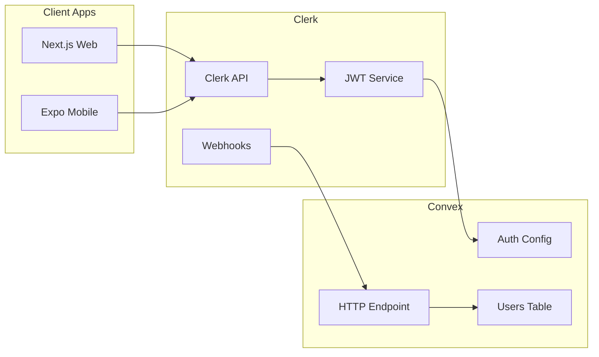
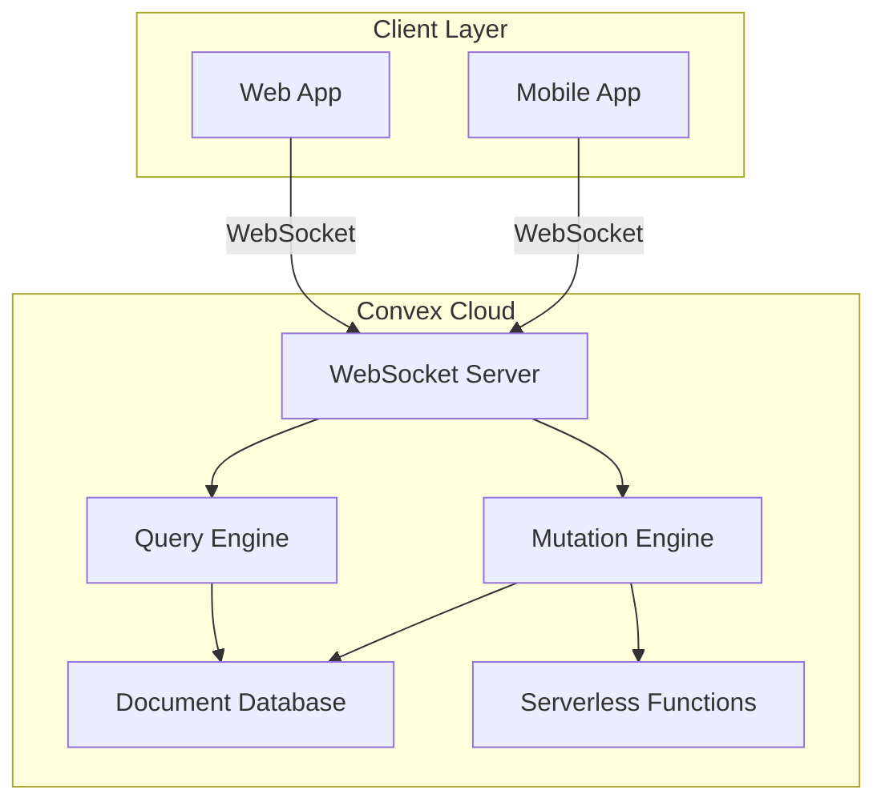
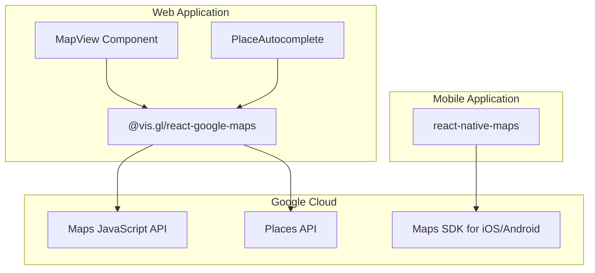

# External Integrations

This document details the external service integrations used in the Ear-Plug application, including Clerk authentication, Convex backend, and Google Maps.

## Related Diagrams

For visual representations of integrations and deployment, see:

- **[System Overview](../diagrams/system-overview.mermaid)** - High-level view of all external service connections
- **[Deployment Diagram](../diagrams/deployment.mermaid)** - Infrastructure showing Vercel, Convex Cloud, Clerk, EAS, and app stores
- **[User Registration Flow](../diagrams/sequence-diagrams/user-registration.mermaid)** - Clerk authentication flow with Convex sync

## Overview

| Service | Purpose | Platforms |
|---------|---------|-----------|
| **Clerk** | Authentication, user management, SSO | Web, Mobile |
| **Convex** | Serverless database, real-time subscriptions | Web, Mobile |
| **Google Maps** | Map display, venue search, geolocation | Web, Mobile |

## Clerk Authentication

### Architecture



### Web Integration

**Package**: `@clerk/nextjs` (^5.0.0)

#### Provider Setup

```typescript
// apps/web/src/app/providers.tsx
import { ClerkProvider } from "@clerk/nextjs";
import { ConvexProviderWithClerk } from "convex/react-clerk";
import { useAuth } from "@clerk/nextjs";

const convex = new ConvexReactClient(process.env.NEXT_PUBLIC_CONVEX_URL!);

export function Providers({ children }: { children: React.ReactNode }) {
  return (
    <ClerkProvider>
      <ConvexProviderWithClerk client={convex} useAuth={useAuth}>
        {children}
      </ConvexProviderWithClerk>
    </ClerkProvider>
  );
}
```

#### Middleware Configuration

```typescript
// apps/web/middleware.ts
import { clerkMiddleware, createRouteMatcher } from "@clerk/nextjs/server";

const isPublicRoute = createRouteMatcher([
  "/",
  "/sign-in(.*)",
  "/sign-up(.*)",
  "/sso-callback(.*)",
]);

export default clerkMiddleware(async (auth, req) => {
  if (!isPublicRoute(req)) {
    await auth().protect();
  }
});

export const config = {
  matcher: ["/((?!.*\\..*|_next).*)", "/", "/(api|trpc)(.*)"],
};
```

#### Environment Variables

```env
NEXT_PUBLIC_CLERK_PUBLISHABLE_KEY=pk_test_...
CLERK_SECRET_KEY=sk_test_...
CLERK_JWT_ISSUER_DOMAIN=https://your-app.clerk.accounts.dev
```

### Mobile Integration

**Package**: `@clerk/clerk-expo` (^2.0.0)

#### Provider Setup with Secure Token Storage

```typescript
// apps/mobile/app/_layout.tsx
import { ClerkProvider } from "@clerk/clerk-expo";
import { ConvexProviderWithClerk } from "convex/react-clerk";
import { useAuth } from "@clerk/clerk-expo";
import * as SecureStore from "expo-secure-store";

// Token cache using expo-secure-store
const tokenCache = {
  async getToken(key: string) {
    try {
      return SecureStore.getItemAsync(key);
    } catch (err) {
      return null;
    }
  },
  async saveToken(key: string, value: string) {
    try {
      return SecureStore.setItemAsync(key, value);
    } catch (err) {
      return;
    }
  },
};

export default function RootLayout() {
  return (
    <ClerkProvider
      publishableKey={process.env.EXPO_PUBLIC_CLERK_PUBLISHABLE_KEY!}
      tokenCache={tokenCache}
    >
      <ConvexProviderWithClerk client={convex} useAuth={useAuth}>
        <Stack />
      </ConvexProviderWithClerk>
    </ClerkProvider>
  );
}
```

#### Environment Variables

```env
EXPO_PUBLIC_CLERK_PUBLISHABLE_KEY=pk_test_...
```

### Webhook Integration

Clerk webhooks sync user creation to the Convex database.

#### HTTP Endpoint

```typescript
// convex/http.ts
import { httpRouter } from "convex/server";
import { Webhook } from "svix";
import { internal } from "./_generated/api";

const http = httpRouter();

http.route({
  path: "/clerk-webhook",
  method: "POST",
  handler: httpAction(async (ctx, request) => {
    const webhookSecret = process.env.CLERK_WEBHOOK_SECRET;

    // Verify webhook signature
    const svix_id = request.headers.get("svix-id");
    const svix_timestamp = request.headers.get("svix-timestamp");
    const svix_signature = request.headers.get("svix-signature");

    const body = await request.text();
    const wh = new Webhook(webhookSecret);

    let evt;
    try {
      evt = wh.verify(body, {
        "svix-id": svix_id!,
        "svix-timestamp": svix_timestamp!,
        "svix-signature": svix_signature!,
      });
    } catch (err) {
      return new Response("Invalid signature", { status: 400 });
    }

    // Handle user.created event
    if (evt.type === "user.created") {
      await ctx.runMutation(internal.users.createUserFromClerk, {
        clerkId: evt.data.id,
        email: evt.data.email_addresses[0]?.email_address ?? "",
        name: `${evt.data.first_name} ${evt.data.last_name}`.trim(),
        avatar: evt.data.image_url,
      });
    }

    return new Response("OK", { status: 200 });
  }),
});

export default http;
```

### JWT Configuration

```typescript
// convex/auth.config.ts
export default {
  providers: [
    {
      domain: "https://your-clerk-domain.clerk.accounts.dev",
      applicationID: "convex",
    },
  ],
};
```

### Clerk Dashboard Setup

1. Create a Clerk application at https://dashboard.clerk.com
2. Configure JWT template:
   - Navigate to JWT Templates
   - Create "Convex" template with `{ "sub": "{{user.id}}" }`
3. Configure webhook endpoint:
   - Navigate to Webhooks
   - Add endpoint: `https://your-convex-url.convex.site/clerk-webhook`
   - Subscribe to `user.created` event

## Convex Backend

### Architecture



### Client Setup

#### Web Client

```typescript
// apps/web/src/app/providers.tsx
import { ConvexReactClient } from "convex/react";

const convex = new ConvexReactClient(process.env.NEXT_PUBLIC_CONVEX_URL!);
```

#### Mobile Client

```typescript
// apps/mobile/app/_layout.tsx
import { ConvexReactClient } from "convex/react";

const convex = new ConvexReactClient(process.env.EXPO_PUBLIC_CONVEX_URL!);
```

### Query Pattern

```typescript
// Using queries in components
import { useQuery } from "convex/react";
import { api } from "../../../../convex/_generated/api";

function EventList() {
  const events = useQuery(api.events.listUpcoming);

  if (events === undefined) {
    return <Loading />;
  }

  return (
    <ul>
      {events.map(event => (
        <li key={event._id}>{event.title}</li>
      ))}
    </ul>
  );
}
```

### Mutation Pattern

```typescript
// Using mutations in components
import { useMutation } from "convex/react";
import { api } from "../../../../convex/_generated/api";

function RsvpButton({ eventId }: { eventId: Id<"events"> }) {
  const rsvp = useMutation(api.events.rsvp);

  const handleClick = async () => {
    await rsvp({ eventId });
  };

  return <button onClick={handleClick}>RSVP</button>;
}
```

### Authentication in Backend

```typescript
// convex/events.ts
import { query, mutation } from "./_generated/server";

export const getCurrentUserEvents = query({
  args: {},
  handler: async (ctx) => {
    // Get authenticated user identity
    const identity = await ctx.auth.getUserIdentity();
    if (!identity) {
      return [];
    }

    // Lookup user in database
    const user = await ctx.db
      .query("users")
      .withIndex("by_clerk_id", (q) => q.eq("clerkId", identity.subject))
      .unique();

    if (!user) {
      return [];
    }

    // Query user's RSVPs
    const rsvps = await ctx.db
      .query("rsvps")
      .withIndex("by_user", (q) => q.eq("userId", user._id))
      .collect();

    // Fetch event details
    const events = await Promise.all(
      rsvps.map(rsvp => ctx.db.get(rsvp.eventId))
    );

    return events.filter(Boolean);
  },
});
```

### Type Generation

Convex automatically generates TypeScript types from your schema:

```bash
# Start dev server to generate types
npx convex dev
```

Generated files in `convex/_generated/`:
- `api.ts` - Function references
- `dataModel.ts` - Table types and ID types
- `server.ts` - Server-side utilities

### Environment Variables

| Variable | Platform | Description |
|----------|----------|-------------|
| `NEXT_PUBLIC_CONVEX_URL` | Web | Convex deployment URL |
| `EXPO_PUBLIC_CONVEX_URL` | Mobile | Convex deployment URL |

## Google Maps Platform

### Architecture



### Web Integration

**Package**: `@vis.gl/react-google-maps` (^1.0.0)

#### Map Provider Setup

```typescript
// apps/web/src/app/layout.tsx or component
import { APIProvider } from "@vis.gl/react-google-maps";

function MapWrapper({ children }) {
  return (
    <APIProvider apiKey={process.env.NEXT_PUBLIC_GOOGLE_MAPS_API_KEY!}>
      {children}
    </APIProvider>
  );
}
```

#### Map Component

```typescript
// apps/web/src/components/fan/MapView.tsx
import { Map, Marker, InfoWindow } from "@vis.gl/react-google-maps";

export function FanMapView() {
  const { events } = useNearbyEvents(location);
  const [selectedEvent, setSelectedEvent] = useState(null);

  return (
    <Map
      defaultCenter={{ lat: 37.7749, lng: -122.4194 }} // San Francisco
      defaultZoom={12}
      mapId="ear-plug-map"
    >
      {events.map(event => (
        <Marker
          key={event._id}
          position={{
            lat: event.venue.coordinates.lat,
            lng: event.venue.coordinates.lng,
          }}
          onClick={() => setSelectedEvent(event)}
        />
      ))}

      {selectedEvent && (
        <InfoWindow
          position={{
            lat: selectedEvent.venue.coordinates.lat,
            lng: selectedEvent.venue.coordinates.lng,
          }}
          onCloseClick={() => setSelectedEvent(null)}
        >
          <EventCard event={selectedEvent} />
        </InfoWindow>
      )}
    </Map>
  );
}
```

#### Place Autocomplete

```typescript
// apps/web/src/components/maps/PlaceAutocomplete.tsx
import usePlacesAutocomplete, {
  getGeocode,
  getLatLng,
} from "use-places-autocomplete";

export function PlaceAutocomplete({ onSelect }) {
  const {
    ready,
    value,
    suggestions: { status, data },
    setValue,
    clearSuggestions,
  } = usePlacesAutocomplete({
    requestOptions: {
      componentRestrictions: { country: "us" },
      types: ["establishment"],
    },
    debounce: 300,
  });

  const handleSelect = async (address: string) => {
    setValue(address, false);
    clearSuggestions();

    const results = await getGeocode({ address });
    const { lat, lng } = await getLatLng(results[0]);

    onSelect({
      address,
      coordinates: { lat, lng },
      placeId: results[0].place_id,
    });
  };

  return (
    <div>
      <input
        value={value}
        onChange={(e) => setValue(e.target.value)}
        disabled={!ready}
        placeholder="Search for a venue..."
      />

      {status === "OK" && (
        <ul>
          {data.map(({ place_id, description }) => (
            <li key={place_id} onClick={() => handleSelect(description)}>
              {description}
            </li>
          ))}
        </ul>
      )}
    </div>
  );
}
```

### Mobile Integration

**Package**: `react-native-maps` (1.14.0)

#### Native Configuration

```json
// app.json
{
  "expo": {
    "ios": {
      "config": {
        "googleMapsApiKey": "YOUR_IOS_API_KEY"
      }
    },
    "android": {
      "config": {
        "googleMaps": {
          "apiKey": "YOUR_ANDROID_API_KEY"
        }
      }
    }
  }
}
```

#### Map Component

```typescript
// apps/mobile/components/MapView.tsx
import MapView, { Marker, Callout } from "react-native-maps";

export function EventMap({ events }) {
  return (
    <MapView
      style={{ flex: 1 }}
      initialRegion={{
        latitude: 37.7749,
        longitude: -122.4194,
        latitudeDelta: 0.1,
        longitudeDelta: 0.1,
      }}
    >
      {events.map(event => (
        <Marker
          key={event._id}
          coordinate={{
            latitude: event.venue.coordinates.lat,
            longitude: event.venue.coordinates.lng,
          }}
        >
          <Callout>
            <Text>{event.title}</Text>
            <Text>{event.venue.name}</Text>
          </Callout>
        </Marker>
      ))}
    </MapView>
  );
}
```

### Google Cloud Setup

#### Required APIs

| API | Purpose | Platform |
|-----|---------|----------|
| Maps JavaScript API | Web map display | Web |
| Places API | Location autocomplete | Web |
| Maps SDK for iOS | Native iOS maps | Mobile |
| Maps SDK for Android | Native Android maps | Mobile |

#### API Key Configuration

1. Create a Google Cloud project
2. Enable required APIs
3. Create API keys with restrictions:

**Web API Key:**
- Application restrictions: HTTP referrers
- Allowed referrers: `localhost:*`, `yourdomain.com/*`
- API restrictions: Maps JavaScript API, Places API

**iOS API Key:**
- Application restrictions: iOS apps
- Bundle ID: `com.yourcompany.earplug`
- API restrictions: Maps SDK for iOS

**Android API Key:**
- Application restrictions: Android apps
- Package name: `com.yourcompany.earplug`
- SHA-1 certificate fingerprint
- API restrictions: Maps SDK for Android

### Environment Variables

| Variable | Platform | Description |
|----------|----------|-------------|
| `NEXT_PUBLIC_GOOGLE_MAPS_API_KEY` | Web | Web API key |
| `EXPO_PUBLIC_GOOGLE_MAPS_API_KEY` | Mobile | Mobile API key (also in app.json) |

## Integration Testing

### Clerk Test Mode

Use Clerk's test mode for development:

```env
# Use test keys (pk_test_*, sk_test_*)
NEXT_PUBLIC_CLERK_PUBLISHABLE_KEY=pk_test_...
CLERK_SECRET_KEY=sk_test_...
```

### Convex Local Development

```bash
# Start local development server
npx convex dev

# This provides:
# - Local function execution
# - Type generation
# - Real-time sync with cloud
```

### Google Maps Development

For development, use unrestricted API keys with billing alerts:

```javascript
// Enable billing alerts in Google Cloud Console
// Set budget alerts at $10, $50, $100
```

## Error Handling

### Clerk Errors

```typescript
import { useAuth } from "@clerk/nextjs";

function ProtectedComponent() {
  const { isLoaded, isSignedIn } = useAuth();

  if (!isLoaded) {
    return <Loading />;
  }

  if (!isSignedIn) {
    return <RedirectToSignIn />;
  }

  return <Content />;
}
```

### Convex Errors

```typescript
const mutation = useMutation(api.events.rsvp);

const handleRsvp = async () => {
  try {
    await mutation({ eventId });
  } catch (error) {
    if (error instanceof ConvexError) {
      // Handle Convex-specific error
      console.error("Convex error:", error.message);
    } else {
      // Handle network or other errors
      console.error("Error:", error);
    }
  }
};
```

### Google Maps Errors

```typescript
import { useApiLoadingStatus } from "@vis.gl/react-google-maps";

function MapContainer() {
  const status = useApiLoadingStatus();

  if (status === "LOADING") {
    return <Loading />;
  }

  if (status === "FAILED") {
    return <ErrorMessage>Failed to load Google Maps</ErrorMessage>;
  }

  return <Map />;
}
```
