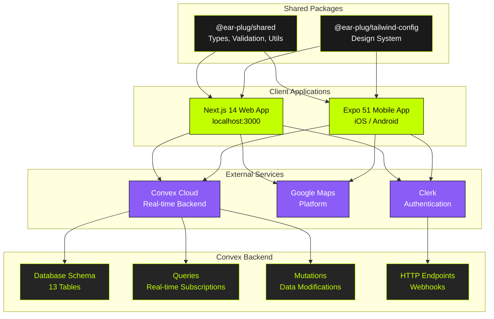
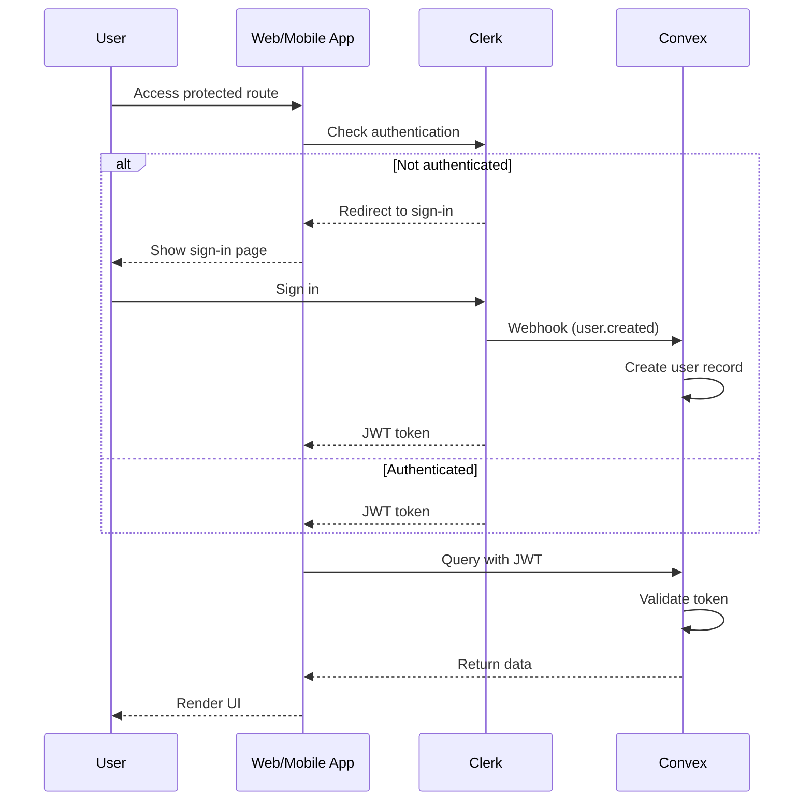

# Architecture Overview

This document provides a high-level overview of the Ear-Plug platform architecture, technology choices, and system design principles.

## System Overview

Ear-Plug is a "Listen Local" platform connecting Bay Area live music fans with musicians and bands. The platform enables:

- **Fans**: Discover live music events, RSVP to shows, follow artists, and explore venues on an interactive map
- **Musicians**: Manage band profiles, book gigs, communicate with venues, and track analytics

## Architecture Diagram

For detailed visual diagrams of the system architecture, see the following Mermaid files:

- **[System Overview](../diagrams/system-overview.mermaid)** - High-level view of all system components including Web App, Mobile App, Convex Backend, Clerk Auth, and Google Maps
- **[Component Diagram](../diagrams/component-diagram.mermaid)** - Detailed module relationships within the monorepo
- **[Deployment Diagram](../diagrams/deployment.mermaid)** - Infrastructure showing Vercel, Convex Cloud, Clerk, and app stores



## Technology Choices

### Frontend

| Technology | Version | Rationale |
|------------|---------|-----------|
| **Next.js 14** | 14.2.0 | App Router provides server components, improved routing, and built-in optimizations. React Server Components reduce client-side JavaScript. |
| **Expo 51** | ~51.0.0 | Cross-platform mobile development with managed workflow. Expo Router enables file-based routing consistent with Next.js patterns. |
| **React 18** | ^18.2.0 | Concurrent features, automatic batching, and Suspense support for better user experience. |
| **TypeScript** | ^5.3.3 | Type safety across the entire stack, shared types between frontend and backend. |

### Backend

| Technology | Rationale |
|------------|-----------|
| **Convex** | Serverless database with real-time subscriptions out of the box. Eliminates need for separate WebSocket infrastructure. TypeScript-first with automatic type generation. |
| **Clerk** | Enterprise-grade authentication with SSO support. Handles user management, sessions, and JWT tokens. Integrates natively with both Next.js and Expo. |

### Styling

| Technology | Rationale |
|------------|-----------|
| **Tailwind CSS** | Utility-first CSS for rapid development. Consistent design tokens across platforms. |
| **NativeWind v4** | Brings Tailwind CSS to React Native, enabling shared styling patterns between web and mobile. |

### Build System

| Technology | Rationale |
|------------|-----------|
| **Turborepo** | Monorepo task orchestration with intelligent caching. Parallel builds and incremental compilation. |
| **pnpm** | Fast, disk-space efficient package manager with strict dependency isolation. Native workspace support. |

## Monorepo Structure

```
Ear-Plug/
├── apps/
│   ├── web/                    # Next.js 14 Application
│   │   ├── src/
│   │   │   ├── app/           # App Router pages
│   │   │   ├── components/    # React components
│   │   │   ├── hooks/         # Custom hooks (Convex wrappers)
│   │   │   └── lib/           # Utilities
│   │   └── middleware.ts      # Clerk route protection
│   │
│   └── mobile/                # Expo 51 Application
│       ├── app/               # Expo Router pages
│       └── assets/            # Static assets
│
├── convex/                    # Convex Backend (shared)
│   ├── schema.ts             # Database schema
│   ├── users.ts              # User queries/mutations
│   ├── bands.ts              # Band management
│   ├── events.ts             # Event operations
│   ├── venues.ts             # Venue operations
│   ├── messages.ts           # Messaging system
│   └── utils/                # Backend utilities
│
├── packages/
│   ├── shared/               # Cross-platform code
│   │   └── src/
│   │       ├── types/        # TypeScript interfaces
│   │       ├── validation/   # Zod schemas
│   │       ├── constants/    # App constants
│   │       └── utils/        # Utility functions
│   │
│   └── tailwind-config/      # Design system
│       └── base.js           # Shared Tailwind config
│
├── package.json              # Root workspace config
├── turbo.json                # Turborepo task config
└── pnpm-workspace.yaml       # Workspace packages
```

## Design Principles

### 1. Type Safety Across the Stack

Types flow from the database schema through to the UI:

```
Convex Schema (validators)
    → Generated Types (_generated/dataModel)
    → Shared Types (packages/shared)
    → Component Props
```

### 2. Real-Time by Default

All data fetching uses Convex's real-time queries. When data changes in the database, UI updates automatically without manual refetching or cache invalidation.

### 3. Role-Based Architecture

The application renders different UI based on user role (`fan` or `musician`):

```typescript
export default function HomePage() {
  const { isFan } = useCurrentUser();

  if (isFan) {
    return <FanMapView />;      // Map-based discovery
  }
  return <BandDashboard />;      // Analytics dashboard
}
```

### 4. Shared Code Between Platforms

Maximum code sharing through the `@ear-plug/shared` package:

- **Types**: Shared TypeScript interfaces
- **Validation**: Zod schemas for input validation
- **Constants**: Genre options, formatting helpers
- **Utilities**: Distance calculation, date formatting

### 5. Progressive Enhancement

- Server-side rendering for initial page loads
- Client-side hydration for interactivity
- Optimistic updates for responsive mutations

## Component Architecture

### Web Components (`apps/web/src/components/`)

```
components/
├── band/                  # Musician-specific components
│   ├── BandDashboard.tsx
│   ├── BandCalendar.tsx
│   ├── BandMessages.tsx
│   ├── CreateGigModal.tsx
│   └── AnalyticsReport.tsx
│
├── fan/                   # Fan-specific components
│   ├── MapView.tsx
│   ├── CalendarView.tsx
│   ├── ProfileView.tsx
│   └── NotificationsView.tsx
│
├── events/               # Shared event components
│   └── EventCard.tsx
│
├── maps/                 # Google Maps integration
│   ├── MapInfoWindow.tsx
│   └── PlaceAutocomplete.tsx
│
├── navigation/           # Navigation components
│   └── BottomNav.tsx
│
├── onboarding/           # Onboarding flow
│   └── OnboardingFlow.tsx
│
└── ui/                   # Reusable UI primitives
    ├── Skeleton.tsx
    ├── GenreFilter.tsx
    └── DistanceSlider.tsx
```

### Custom Hooks (`apps/web/src/hooks/`)

Hooks wrap Convex queries and mutations with a consistent interface:

| Hook | Purpose |
|------|---------|
| `useCurrentUser()` | Current user state and mutations |
| `useEvents()` | Event queries with filters |
| `useNearbyEvents()` | Geolocation-based event discovery |
| `useBand()` | Band management |
| `useVenues()` | Venue queries |
| `useMessages()` | Messaging system |
| `useGeolocation()` | Browser geolocation API |

## Security Architecture

### Authentication Flow

For detailed sequence diagrams of authentication and other flows, see:

- **[User Registration Flow](../diagrams/sequence-diagrams/user-registration.mermaid)** - Complete Clerk signup to Convex user creation
- **[Event Creation Flow](../diagrams/sequence-diagrams/event-creation.mermaid)** - Musician creates event, notifications sent
- **[RSVP Flow](../diagrams/sequence-diagrams/rsvp-flow.mermaid)** - Fan RSVPs to event, count updates
- **[Messaging Flow](../diagrams/sequence-diagrams/messaging-flow.mermaid)** - Band-venue conversation flow



### Route Protection

Protected routes are enforced at multiple levels:

1. **Middleware**: Clerk middleware intercepts requests to protected routes
2. **Backend**: Convex queries/mutations validate JWT tokens
3. **Component**: UI components check user state before rendering

```typescript
// apps/web/middleware.ts
const isPublicRoute = createRouteMatcher([
  "/",
  "/sign-in(.*)",
  "/sign-up(.*)",
  "/sso-callback(.*)",
]);

export default clerkMiddleware(async (auth, req) => {
  if (!isPublicRoute(req)) {
    await auth().protect();
  }
});
```

## Performance Considerations

### Build Optimizations

- **Turborepo caching**: Incremental builds based on file changes
- **Tree shaking**: Unused code eliminated in production
- **Code splitting**: Automatic route-based code splitting in Next.js

### Runtime Optimizations

- **Real-time subscriptions**: Efficient delta updates instead of full refetches
- **Optimistic updates**: UI updates immediately while mutations process
- **Image optimization**: Next.js Image component for automatic optimization
- **Connection pooling**: Convex manages database connections

### Mobile Optimizations

- **Expo prebuild**: Native module optimization
- **Bundle splitting**: Hermes JavaScript engine on React Native
- **Lazy loading**: Screens loaded on demand via Expo Router
