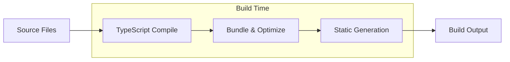
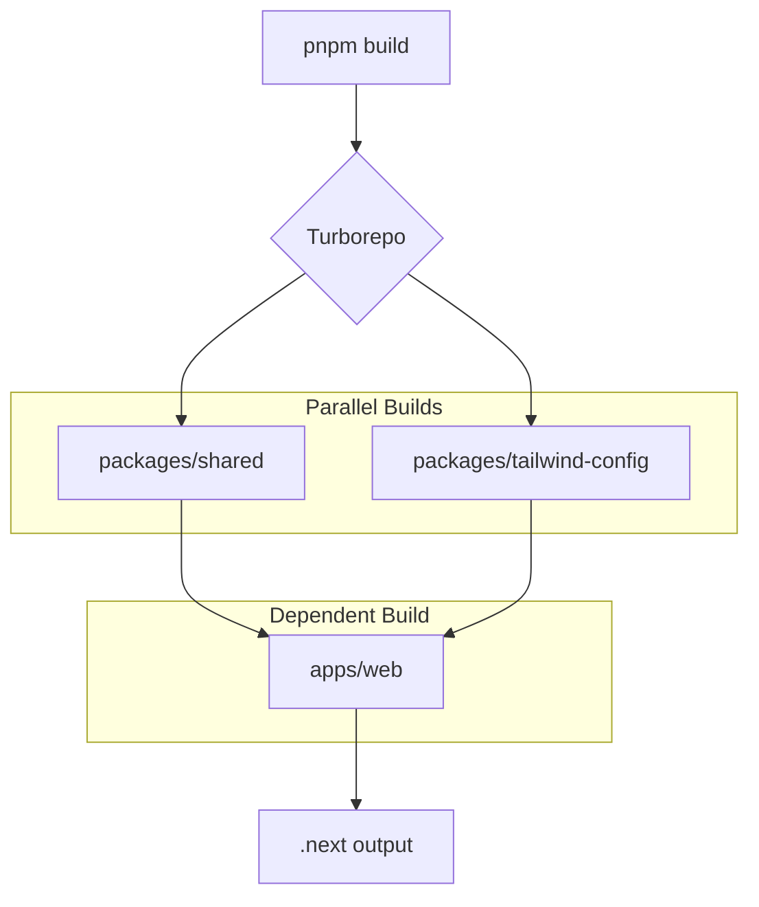

# Building

This document covers the build system, commands, and processes for the Ear-Plug project.

## Build System Overview

Ear-Plug uses **Turborepo** for monorepo build orchestration. Key benefits:

- **Parallel execution**: Independent tasks run simultaneously
- **Intelligent caching**: Unchanged packages skip rebuilds
- **Dependency awareness**: Tasks wait for dependent packages to complete

## Turborepo Configuration

```json
// turbo.json
{
  "$schema": "https://turbo.build/schema.json",
  "globalDependencies": ["**/.env.*local"],
  "tasks": {
    "build": {
      "dependsOn": ["^build"],
      "outputs": [".next/**", "!.next/cache/**", "dist/**"]
    },
    "dev": {
      "cache": false,
      "persistent": true
    },
    "lint": {},
    "typecheck": {},
    "clean": {
      "cache": false
    }
  }
}
```

### Task Configuration

| Task | Cache | Dependencies | Description |
|------|-------|--------------|-------------|
| `build` | Yes | `^build` (all deps) | Production builds |
| `dev` | No | None | Development servers |
| `lint` | Yes | None | ESLint checks |
| `typecheck` | Yes | None | TypeScript checks |
| `clean` | No | None | Remove artifacts |

## Build Commands

### Root Level Commands

All commands run from the project root (`/`):

```bash
# Build all packages and apps
pnpm build

# Build specific app
pnpm build:web

# Type checking
pnpm typecheck

# Linting
pnpm lint

# Clean all build artifacts
pnpm clean
```

### Filtering Builds

Turborepo supports filtering by package:

```bash
# Build only web app and its dependencies
turbo build --filter=@ear-plug/web

# Build only shared package
turbo build --filter=@ear-plug/shared

# Build everything except mobile
turbo build --filter=!@ear-plug/mobile
```

## Web Application Build

### Development Build

```bash
# Start development server
pnpm dev:web
# or from apps/web:
pnpm dev
```

Development features:
- Hot Module Replacement (HMR)
- Error overlay
- Fast Refresh for React components
- TypeScript error reporting

### Production Build

```bash
# Build for production
pnpm build:web
```

This creates:
- Optimized JavaScript bundles
- Static HTML for static pages
- Server-side rendering setup
- Image optimization

### Build Output

```
apps/web/.next/
├── cache/              # Build cache (excluded from turbo cache)
├── server/             # Server-side bundles
├── static/             # Static assets
└── standalone/         # Standalone deployment bundle
```

### Next.js Build Phases



### Production Server

```bash
# After building, start production server
cd apps/web
pnpm start
```

## Mobile Application Build

### Development Build

```bash
# Start Expo development server
pnpm dev:mobile

# Or specific platforms
cd apps/mobile
pnpm ios      # iOS simulator
pnpm android  # Android emulator
```

### Production Build (EAS)

For production mobile builds, use Expo Application Services (EAS):

```bash
# Install EAS CLI
npm install -g eas-cli

# Configure EAS (one-time)
cd apps/mobile
eas build:configure

# Build for iOS
eas build --platform ios

# Build for Android
eas build --platform android

# Build for both
eas build --platform all
```

### EAS Configuration

Create `apps/mobile/eas.json`:

```json
{
  "cli": {
    "version": ">= 3.0.0"
  },
  "build": {
    "development": {
      "developmentClient": true,
      "distribution": "internal"
    },
    "preview": {
      "distribution": "internal"
    },
    "production": {}
  },
  "submit": {
    "production": {}
  }
}
```

### Local Native Builds

For local native builds without EAS:

```bash
# Generate native projects
npx expo prebuild

# Build iOS locally (requires Xcode)
npx expo run:ios --configuration Release

# Build Android locally (requires Android Studio)
npx expo run:android --variant release
```

## Shared Packages Build

### @ear-plug/shared

```bash
# Build shared package
cd packages/shared
pnpm build

# Or from root
turbo build --filter=@ear-plug/shared
```

The shared package exports:
- TypeScript types
- Zod validation schemas
- Constants
- Utility functions

### @ear-plug/tailwind-config

This package exports configuration only (no build step):

```javascript
// packages/tailwind-config/base.js
module.exports = {
  theme: {
    extend: {
      colors: {
        lime: "#C2FF00",
        violet: "#8B5CF6",
        night: "#0F0F0F",
      },
      // ...
    },
  },
};
```

## Convex Backend Build

### Development

```bash
# Start development with type generation
npx convex dev
```

This:
- Watches for file changes
- Pushes functions to development deployment
- Regenerates TypeScript types in `convex/_generated/`

### Production Deployment

```bash
# Deploy to production
npx convex deploy
```

**Important**: Always run `npx convex deploy` before deploying frontend applications to ensure backend functions are up to date.

## Build Pipeline

### Full Build Flow



### Build Order

1. **Shared packages** (parallel):
   - `@ear-plug/shared`
   - `@ear-plug/tailwind-config`

2. **Applications** (after dependencies):
   - `@ear-plug/web` (depends on shared packages)

### Caching

Turborepo caches build outputs based on:
- Input file hashes
- Environment variables (from `globalDependencies`)
- Task configuration

Cache locations:
- Local: `.turbo/` in each package
- Remote: (Optional) Configure remote cache for CI/CD

## Environment-Specific Builds

### Development vs Production

| Aspect | Development | Production |
|--------|-------------|------------|
| Minification | No | Yes |
| Source maps | Full | Limited |
| Error messages | Detailed | Generic |
| Hot reload | Yes | No |
| Build time | Fast | Slower |

### Environment Variables

Environment variables are loaded per-environment:

```bash
# Development
apps/web/.env.local

# Production (set in deployment platform)
NEXT_PUBLIC_CONVEX_URL=...
NEXT_PUBLIC_CLERK_PUBLISHABLE_KEY=...
```

## Build Optimization

### Turbo Cache

Enable remote caching for faster CI builds:

```bash
# Link to Vercel Remote Cache
npx turbo login
npx turbo link
```

### Parallel Builds

Turborepo automatically parallelizes independent tasks. Monitor with:

```bash
# Verbose output showing parallelization
turbo build --log-order=stream
```

### Incremental Builds

Turborepo only rebuilds changed packages:

```bash
# See what would rebuild
turbo build --dry-run

# Force full rebuild
turbo build --force
```

## Build Troubleshooting

### Common Issues

#### 1. Stale Build Cache

```bash
# Clear Turborepo cache
turbo clean

# Or remove manually
rm -rf .turbo
rm -rf node_modules/.cache
```

#### 2. TypeScript Errors in Build

```bash
# Run typecheck separately to see all errors
pnpm typecheck

# Check specific package
turbo typecheck --filter=@ear-plug/web
```

#### 3. Missing Dependencies

```bash
# Ensure all dependencies are installed
pnpm install

# Rebuild shared packages
turbo build --filter=@ear-plug/shared
```

#### 4. Environment Variables Not Available

```bash
# Ensure variables have correct prefixes
# Client-side: NEXT_PUBLIC_* or EXPO_PUBLIC_*
# Server-side: No prefix needed

# After changing .env files, restart the build
turbo build --force
```

#### 5. Out of Memory

```bash
# Increase Node.js memory limit
NODE_OPTIONS="--max-old-space-size=8192" pnpm build
```

### Build Debugging

```bash
# Verbose output
turbo build --verbosity=2

# Graph of task dependencies
turbo build --graph

# Dry run to see what would execute
turbo build --dry-run=json
```

## CI/CD Build

### GitHub Actions Example

```yaml
# .github/workflows/build.yml
name: Build

on:
  push:
    branches: [main]
  pull_request:
    branches: [main]

jobs:
  build:
    runs-on: ubuntu-latest

    steps:
      - uses: actions/checkout@v4

      - uses: pnpm/action-setup@v2
        with:
          version: 9

      - uses: actions/setup-node@v4
        with:
          node-version: 20
          cache: 'pnpm'

      - name: Install dependencies
        run: pnpm install

      - name: Type check
        run: pnpm typecheck

      - name: Lint
        run: pnpm lint

      - name: Build
        run: pnpm build
        env:
          NEXT_PUBLIC_CONVEX_URL: ${{ secrets.CONVEX_URL }}
          NEXT_PUBLIC_CLERK_PUBLISHABLE_KEY: ${{ secrets.CLERK_KEY }}
```

## Build Artifacts

### What Gets Built

| Package | Output | Location |
|---------|--------|----------|
| `@ear-plug/web` | Next.js bundle | `apps/web/.next/` |
| `@ear-plug/shared` | CommonJS + ESM | `packages/shared/dist/` |

### Artifact Inspection

```bash
# Analyze Next.js bundle
cd apps/web
npx @next/bundle-analyzer

# View build stats
cat apps/web/.next/build-manifest.json
```
