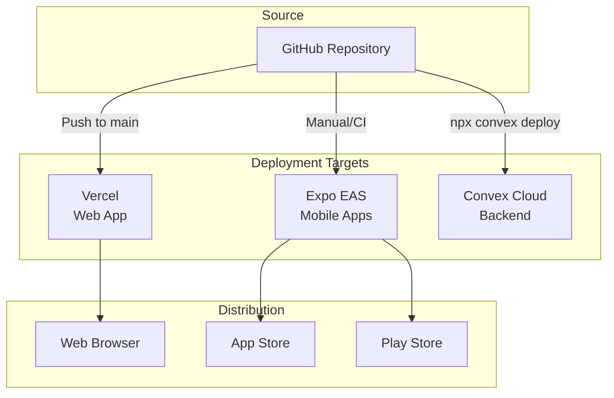

# Deployment

This document covers the deployment processes for the Ear-Plug application across all platforms: Vercel (web), Expo/EAS (mobile), and Convex (backend).

## Deployment Overview



## Prerequisites

Before deploying:

1. **Environment variables** configured in each platform
2. **Convex backend** deployed first (types must match)
3. **API keys** obtained and configured
4. **Domain** configured (optional for custom domains)

## Convex Backend Deployment

### Development Deployment

During development, `npx convex dev` automatically syncs changes:

```bash
# Start development mode (auto-deploys on save)
npx convex dev
```

### Production Deployment

```bash
# Deploy to production
npx convex deploy
```

**Important**: Always deploy Convex before deploying frontend applications to ensure backend functions are up to date.

### Environment Variables

Set environment variables in the Convex dashboard:

1. Go to https://dashboard.convex.dev
2. Select your project
3. Navigate to Settings > Environment Variables
4. Add variables (e.g., `CLERK_WEBHOOK_SECRET`)

### Deployment Verification

```bash
# Verify deployment
npx convex function list

# Check logs
npx convex logs
```

### Rollback

Convex maintains deployment history. To rollback:

1. Go to Convex Dashboard > Deployments
2. Select a previous deployment
3. Click "Rollback to this deployment"

## Web Application Deployment (Vercel)

### Initial Setup

1. **Connect Repository**:
   - Go to https://vercel.com
   - Import your GitHub repository
   - Select the `apps/web` directory as the root

2. **Configure Build Settings**:
   ```
   Build Command: pnpm build
   Output Directory: .next
   Install Command: pnpm install
   Root Directory: apps/web
   ```

3. **Environment Variables**:
   Add in Vercel Dashboard > Settings > Environment Variables:
   ```
   NEXT_PUBLIC_CONVEX_URL=https://your-project.convex.cloud
   NEXT_PUBLIC_CLERK_PUBLISHABLE_KEY=pk_live_...
   CLERK_SECRET_KEY=sk_live_...
   CLERK_JWT_ISSUER_DOMAIN=https://your-app.clerk.accounts.dev
   NEXT_PUBLIC_GOOGLE_MAPS_API_KEY=AIza...
   ```

### Deployment Methods

#### Automatic Deployment

Vercel automatically deploys on:
- Push to `main` branch (production)
- Pull request creation (preview)

#### Manual Deployment

```bash
# Install Vercel CLI
npm install -g vercel

# Deploy to preview
vercel

# Deploy to production
vercel --prod
```

### Vercel Configuration

Create `apps/web/vercel.json`:

```json
{
  "buildCommand": "pnpm build",
  "installCommand": "pnpm install",
  "framework": "nextjs",
  "regions": ["sfo1"],
  "headers": [
    {
      "source": "/(.*)",
      "headers": [
        {
          "key": "X-Content-Type-Options",
          "value": "nosniff"
        },
        {
          "key": "X-Frame-Options",
          "value": "DENY"
        },
        {
          "key": "X-XSS-Protection",
          "value": "1; mode=block"
        }
      ]
    }
  ]
}
```

### Domain Configuration

1. Go to Vercel Dashboard > Domains
2. Add your custom domain
3. Configure DNS records as instructed
4. SSL certificate is automatically provisioned

### Health Checks

Create a health check endpoint:

```typescript
// apps/web/src/app/api/health/route.ts
export async function GET() {
  return Response.json({
    status: 'healthy',
    timestamp: new Date().toISOString(),
  });
}
```

### Monitoring

Vercel provides built-in monitoring:
- **Analytics**: Page views, performance metrics
- **Logs**: Function logs, error logs
- **Speed Insights**: Core Web Vitals

## Mobile Application Deployment (Expo EAS)

### Initial Setup

1. **Install EAS CLI**:
   ```bash
   npm install -g eas-cli
   ```

2. **Login to Expo**:
   ```bash
   eas login
   ```

3. **Configure EAS**:
   ```bash
   cd apps/mobile
   eas build:configure
   ```

### EAS Configuration

Create `apps/mobile/eas.json`:

```json
{
  "cli": {
    "version": ">= 5.0.0"
  },
  "build": {
    "development": {
      "developmentClient": true,
      "distribution": "internal",
      "ios": {
        "simulator": true
      }
    },
    "preview": {
      "distribution": "internal",
      "ios": {
        "simulator": false
      }
    },
    "production": {
      "autoIncrement": true
    }
  },
  "submit": {
    "production": {
      "ios": {
        "appleId": "your-apple-id@email.com",
        "ascAppId": "1234567890",
        "appleTeamId": "XXXXXXXXXX"
      },
      "android": {
        "serviceAccountKeyPath": "./google-service-account.json"
      }
    }
  }
}
```

### Environment Variables

Set in EAS:

```bash
# Set secret
eas secret:create --name EXPO_PUBLIC_CONVEX_URL --value "https://your-project.convex.cloud"
eas secret:create --name EXPO_PUBLIC_CLERK_PUBLISHABLE_KEY --value "pk_live_..."
```

Or use `.env` files:

```
# apps/mobile/.env.production
EXPO_PUBLIC_CONVEX_URL=https://your-project.convex.cloud
EXPO_PUBLIC_CLERK_PUBLISHABLE_KEY=pk_live_...
```

### Building

#### Development Build

```bash
# Build for development (includes dev tools)
eas build --profile development --platform all
```

#### Preview Build

```bash
# Build for internal testing
eas build --profile preview --platform all
```

#### Production Build

```bash
# Build for app stores
eas build --profile production --platform all

# Or specific platform
eas build --profile production --platform ios
eas build --profile production --platform android
```

### App Store Submission

#### iOS (App Store)

```bash
# Submit to App Store Connect
eas submit --platform ios --latest
```

Requirements:
- Apple Developer account ($99/year)
- App Store Connect app created
- Signing certificates configured

#### Android (Play Store)

```bash
# Submit to Google Play
eas submit --platform android --latest
```

Requirements:
- Google Play Developer account ($25 one-time)
- Google Play Console app created
- Service account with API access

### Over-the-Air Updates

For quick updates without app store review:

```bash
# Publish OTA update
eas update --branch production --message "Bug fix"
```

Configure in `app.json`:

```json
{
  "expo": {
    "updates": {
      "url": "https://u.expo.dev/your-project-id"
    },
    "runtimeVersion": {
      "policy": "sdkVersion"
    }
  }
}
```

## CI/CD Pipeline

### GitHub Actions Workflow

```yaml
# .github/workflows/deploy.yml
name: Deploy

on:
  push:
    branches: [main]
  workflow_dispatch:

jobs:
  deploy-convex:
    runs-on: ubuntu-latest
    steps:
      - uses: actions/checkout@v4

      - uses: pnpm/action-setup@v2
        with:
          version: 9

      - uses: actions/setup-node@v4
        with:
          node-version: 20
          cache: 'pnpm'

      - name: Install dependencies
        run: pnpm install

      - name: Deploy Convex
        run: npx convex deploy
        env:
          CONVEX_DEPLOY_KEY: ${{ secrets.CONVEX_DEPLOY_KEY }}

  deploy-web:
    needs: deploy-convex
    runs-on: ubuntu-latest
    steps:
      - uses: actions/checkout@v4

      - name: Deploy to Vercel
        uses: amondnet/vercel-action@v25
        with:
          vercel-token: ${{ secrets.VERCEL_TOKEN }}
          vercel-org-id: ${{ secrets.VERCEL_ORG_ID }}
          vercel-project-id: ${{ secrets.VERCEL_PROJECT_ID }}
          working-directory: apps/web
          vercel-args: '--prod'

  deploy-mobile:
    needs: deploy-convex
    runs-on: ubuntu-latest
    if: github.event_name == 'workflow_dispatch'
    steps:
      - uses: actions/checkout@v4

      - uses: pnpm/action-setup@v2
        with:
          version: 9

      - uses: actions/setup-node@v4
        with:
          node-version: 20
          cache: 'pnpm'

      - name: Setup Expo
        uses: expo/expo-github-action@v8
        with:
          eas-version: latest
          token: ${{ secrets.EXPO_TOKEN }}

      - name: Install dependencies
        run: pnpm install

      - name: Build and Submit
        run: |
          cd apps/mobile
          eas build --platform all --non-interactive --auto-submit
```

## Environment Configuration

### Development vs Production

| Variable | Development | Production |
|----------|-------------|------------|
| `NEXT_PUBLIC_CONVEX_URL` | Dev deployment URL | Prod deployment URL |
| `NEXT_PUBLIC_CLERK_*` | Test keys (`pk_test_*`) | Live keys (`pk_live_*`) |
| `CLERK_SECRET_KEY` | Test secret | Live secret |
| `GOOGLE_MAPS_API_KEY` | Development key | Production key (restricted) |

### Switching Environments

For Convex:
```bash
# Switch to production deployment
npx convex switch production

# Switch back to development
npx convex switch development
```

## Deployment Checklist

### Pre-Deployment

- [ ] All tests passing
- [ ] Type checking passes (`pnpm typecheck`)
- [ ] Linting passes (`pnpm lint`)
- [ ] Environment variables set for target environment
- [ ] Database migrations applied (if any)
- [ ] API keys are production keys (not test keys)

### Convex Deployment

- [ ] Deploy Convex first: `npx convex deploy`
- [ ] Verify functions deployed: `npx convex function list`
- [ ] Check logs for errors: `npx convex logs`

### Web Deployment

- [ ] Convex deployed and verified
- [ ] Environment variables set in Vercel
- [ ] Build succeeds locally: `pnpm build:web`
- [ ] Deploy: `vercel --prod`
- [ ] Verify site loads correctly
- [ ] Test authentication flow
- [ ] Check for console errors

### Mobile Deployment

- [ ] Convex deployed and verified
- [ ] EAS secrets configured
- [ ] Build succeeds: `eas build --profile production`
- [ ] Test on physical devices
- [ ] Submit to stores: `eas submit`

### Post-Deployment

- [ ] Verify all features work
- [ ] Monitor logs for errors
- [ ] Check analytics for issues
- [ ] Notify team of deployment

## Rollback Procedures

### Vercel Rollback

1. Go to Vercel Dashboard > Deployments
2. Find the previous working deployment
3. Click "..." > "Promote to Production"

Or via CLI:
```bash
vercel rollback
```

### Convex Rollback

1. Go to Convex Dashboard > Deployments
2. Select previous deployment
3. Click "Rollback"

### Mobile Rollback

For native builds, submit a new version. For OTA updates:
```bash
# Rollback to previous update
eas update:rollback --branch production
```

## Monitoring & Alerts

### Vercel Analytics

Enable in Vercel Dashboard:
- Web Analytics
- Speed Insights
- Function Logs

### Convex Monitoring

Available in Convex Dashboard:
- Function execution logs
- Error tracking
- Usage metrics

### Error Tracking (Recommended)

Consider adding Sentry for comprehensive error tracking:

```bash
# Install Sentry
pnpm add @sentry/nextjs
```

```typescript
// sentry.client.config.ts
import * as Sentry from "@sentry/nextjs";

Sentry.init({
  dsn: process.env.NEXT_PUBLIC_SENTRY_DSN,
  environment: process.env.NODE_ENV,
  tracesSampleRate: 1.0,
});
```

## Security Considerations

### API Key Protection

1. **Never commit** API keys to Git
2. **Restrict** Google Maps API key to specific domains
3. **Use environment variables** for all secrets
4. **Rotate keys** periodically

### Clerk Security

1. Use **production keys** for production (`pk_live_*`, `sk_live_*`)
2. Configure **allowed origins** in Clerk Dashboard
3. Enable **attack protection** features

### Convex Security

1. All functions are **authenticated by default** when using Clerk integration
2. Validate **input data** in all mutations
3. Check **authorization** for sensitive operations

## Cost Considerations

### Vercel

- **Free tier**: 100GB bandwidth, 100 builds/month
- **Pro**: $20/user/month for teams

### Convex

- **Free tier**: 1M function calls/month
- **Pro**: $25/month for higher limits

### Expo EAS

- **Free tier**: 30 builds/month
- **Production**: $99/month for unlimited builds

### Google Maps

- **Free tier**: $200 credit/month
- Monitor usage in Google Cloud Console
